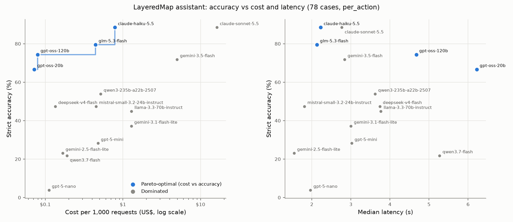

# LLM evaluation for LayeredMap Pro

**Question.** Which model on OpenRouter should turn an Ask-box request (English or Chinese) into calls to
LayeredMap's certified actions at the best balance of accuracy, cost and latency? The model only
translates. It picks actions and fills their inputs, and LayeredMap checks the plan and runs it
locally (spec › Product tiers, Phase 7).

**Answer (2026-10-17).**
- **Default model: `anthropic/claude-haiku-5.5`.** Strict accuracy was 88% in the main run and 81% in
  a repeat; lenient accuracy was 94%. It costs **US$0.79 per 1,000 requests**, has a median latency of
  2.2 s, and refused or asked honestly on every unanswerable case.
- **Fallback: `z-ai/glm-5.3-flash`.** It scored 77–83% strict, costs US$0.20–0.45 per 1,000 requests,
  and has a median latency of 2.1–4.6 s. It comes from a different vendor, so an Anthropic outage
  doesn't take both down.
- **Budget option: `openai/gpt-oss-120b`.** It scored 72–74% strict and 88% lenient, at US$0.08 per
  1,000 requests. Its median latency is 4.7 s.
- **Don't escalate to a stronger model.** Claude Sonnet 5.5 matched Haiku (88% strict) at 20× the
  cost, and Gemini 3.5 Flash scored lower (72%). The remaining errors come mostly from the interface,
  not from model strength: object names given in Chinese, extra display calls, and one incomplete tool
  description. Fixing those in the app should do more than any escalation.
- **Cost per active user per month** with the default: about **US$0.016 at 20 requests** and
  **US$0.08 at 100**. With a 2× margin for bigger maps and plan-check retries, that is US$0.03–0.16.
- **Not yet at Gate 7.** No model reached Gate 7's 90% on answerable questions in this benchmark.
  Four of those cases can't be solved without feature values (see Failure analysis), so the reachable
  ceiling under the value-free rule is about 94%.

Total spent: **US$2.71 of the US$3 cap**. This covers every run, including smoke tests and diagnostics.

## Method

The harness lives in `tools/lm/llm_eval/` (see its README for the details and how to rerun).

**Tools.** The tools are generated from the app's own sources:
- the 13 connected actions, from `ACTIONS` in `crates/lm-jobs/src/actions.rs`;
- their inputs in the runner's order, from that file's module-doc table;
- labels and methods, from `crates/lm-actions/rules.toml`.

Layers are named by their display name. One object is `{layer, field, value}`; leaving out field and
value means the selected object or a drawn area. Distances use the runner's format ("500 m", "3 mi").
There are also four display tools, `filter` (the ten conditions in `lm-core/src/filter.rs`),
`color_by`, `view_data` and `zoom_to`, and two meta tools, `ask_user` and `cannot_do`. A later step
refers to an earlier step's new layer as `#n`.

**Map context.** The system message holds a short instruction, the open layers (name, kind, count,
fields with types and declared units) and the selection. It is **value-free** (WP7.2), at 274–307
tokens (o200k). The "with category values" variant adds the values of category fields (continent,
school type, park kind, capital), which costs 15–32 more tokens.

**Cases.** 78 cases were written by hand against the real files: the world examples, and the Shanghai
fixtures V1, T1 and V9. They cover:

| Category | Cases | What it tests |
|---|---:|---|
| Every connected action | 27 | Each action at least once, plus extra cases for some |
| Filters and styling | 17 filter, 3 style, 2 display | The display tools |
| Multi-step plans | 11 | e.g. add raster values → filter → count |
| Chinese | 17 | |
| Vague requests | 5 | Should ask one question |
| Impossible requests | 6 | Should refuse |
| Wrong-layer traps | 7 | A field that exists only on another layer |
| Unit conversions | 11 | miles, feet, hectares, 公里, 米, million US$, 一亿 |

**Runs.** Requests go through OpenRouter chat completions with tools.
- Settings: `temperature 0` where the model accepts it, and `usage: {include: true}` so the real cost
  is recorded. Reasoning is set to the lowest level the catalog allows: off where it is optional,
  otherwise `minimal` or `low`.
- Each case is a short loop. Every tool call gets a stub result ("Step #k added to the plan (not run
  yet)", plus the new layer's fields), and the model may continue for up to 5 turns.
- Tokens, cost and latency are summed over all turns. The smoke test showed why the loop is needed:
  in a single turn, most models emit only the first step of a multi-step plan.
- Retries use backoff on 429 and 5xx errors. Concurrency is capped, and a hard budget cap is enforced.

**Scoring.** Each case gets two scores; the exact rules are in the README.
- **Strict:** could LayeredMap run the plan as is? That means the same calls in the same order with
  nothing extra, exact layer and field names, and an object named by a (field, value) pair that exists
  in the data. Distances must be readable by the runner's parser and within 0.5%, and filter
  operators must be exactly as defined.
- **Lenient:** could a forgiving plan checker repair it? This accepts differences in letter case,
  Chinese units, operator synonyms, extra zoom/table/color calls, repeated calls and plain-text
  questions or refusals.

Accuracy is computed over all 78 cases. A request that failed after retries counts as wrong.

**Shortlist.** I took the 15 candidates from the brief. All of them are in the 2026-10-17 catalog with
`tools` support. The 12 cheap models cost US$0.02–0.25 per million input tokens. The three references
were Claude Haiku 5.5, Claude Sonnet 5.5 and Gemini 3.5 Flash; Haiku turned out to be cheap enough to
count as a candidate.

## Results: one tool per action (design A), value-free

Tokens are per request, summed over turns. Cost is OpenRouter's reported cost. \* marks the Pareto
front on cost vs strict accuracy.

| Model | Strict | Lenient | US$ / 1,000 req | Median s | p90 s | Prompt tok | Completion tok | Reasoning tok |
|---|---:|---:|---:|---:|---:|---:|---:|---:|
| anthropic/claude-haiku-5.5 \* | **88%** | 94% | 0.790 | 2.23 | 3.07 | 6,868 | 222 | 0 |
| anthropic/claude-sonnet-5.5 | 88% | 95% | 16.251 | 2.77 | 4.84 | 7,227 | 196 | 9 |
| z-ai/glm-5.3-flash \* | 79% | 85% | 0.445 | 2.13 | 6.87 | 5,104 | 122 | 37 |
| openai/gpt-oss-120b \* | 74% | 88% | 0.079 | 4.67 | 8.57 | 3,062 | 142 | 67 |
| google/gemini-3.5-flash | 72% | 92% | 4.977 | 2.84 | 4.28 | 2,885 | 78 | 0 |
| openai/gpt-oss-20b \* | 67% | 72% | 0.072 | 6.22 | 15.45 | 3,019 | 138 | 24 |
| qwen/qwen3-235b-a22b-2507 | 54% | 85% | 0.516 | 3.62 | 7.41 | 6,364 | 109 | 0 |
| deepseek/deepseek-v4-flash | 47% | 82% | 0.134 | 3.74 | 10.98 | 6,992 | 222 | 0 |
| mistralai/mistral-small-3.2-24b-instruct | 47% | 77% | 0.452 | 1.81 | 4.08 | 5,852 | 87 | 0 |
| meta-llama/llama-3.3-70b-instruct | 45% | 68% | 1.289 | 3.76 | 8.83 | 9,767 | 95 | 0 |
| google/gemini-3.1-flash-lite | 37% | 74% | 1.281 | 3.00 | 5.05 | 4,590 | 98 | 0 |
| openai/gpt-5-mini | 28% | 47% | 0.476 | 3.02 | 4.43 | 2,187 | 161 | 0 |
| google/gemini-2.5-flash-lite | 23% | 38% | 0.167 | 1.55 | 4.85 | 830 | 273 | 253 |
| qwen/qwen3.7-flash | 22% | 72% | 0.190 | 5.27 | 8.31 | 10,112 | 308 | 0 |
| openai/gpt-5-nano | 4% | 10% | 0.111 | 1.97 | 4.81 | 1,960 | 225 | 0 |

**Metrics shaped like Gate 7.** The answerable set is 64 cases; the unanswerable set is the 9 cases
that should be refused, or where refusing is right.

| Model | Answerable, strict | Answerable, lenient | Honest refusal (lenient) |
|---|---:|---:|---:|
| claude-haiku-5.5 | 88% (repeat 81%) | 92% | 100% (repeat 100%) |
| claude-sonnet-5.5 | 88% | 95% | 89% |
| glm-5.3-flash | 77% (repeat 77%) | 83% | 89% |
| gpt-oss-120b | 70% (repeat 69%) | 86% | 100% |
| gemini-3.5-flash | 73% | 94% | 89% |
| gpt-oss-20b | 77% | 80% | 11% |

**Repeatability.** I ran Haiku, GLM and gpt-oss-120b a second time with identical settings. The
second run gave 81%, 77% and 72% (against 88%, 79% and 74%). Anthropic models on OpenRouter don't
accept `temperature`, so Haiku varies most. Treat differences under about 5 points as noise.

**Chinese.** On the 17 Chinese cases, the top models scored 76% (Haiku, Sonnet) and 65% (GLM, Gemini
3.5 Flash). Three of those cases need values; see below.

## Tool design: one tool per action (A) vs a single `run_action` (B)

| | A: one tool per action | B: `run_action` with an enum |
|---|---|---|
| Tool schema (o200k estimate) | 19 tools, ~1,670 tokens | 7 tools, ~1,130 tokens |
| Measured prompt tokens per request (Haiku, all turns) | 6,868 | 4,985 (−27%) |
| Haiku strict / lenient | **88% / 94%** | 76% / 79% |
| GLM-5.3-flash | **79% / 85%** | 65% / 72% |
| gpt-oss-120b | **74% / 88%** | 69% / 82% |
| gpt-oss-20b | 67% / 72% | 65% / 74% |
| Gemini 2.5 Flash Lite | 23% / 38% | **53% / 67%** |
| Mean strict over the 12 models run on both | 48% | 45% |

B's tool schema is about 33% smaller (~1,130 vs ~1,670 tokens), and a request sends 15–30% fewer
prompt tokens. Its accuracy is lower for every strong model, though: Haiku's accuracy on single actions
fell from 85% to 63%. The single tool's positional `layers` list and its generic `object` lose the
named roles, so inputs get swapped or misplaced. The one exception is Gemini 2.5 Flash Lite, which
fails with `MALFORMED_FUNCTION_CALL` on 32 of the 78 requests when it has 19 tools and does better with
one.

**Recommendation: design A.** The saved tokens are worth less than the accuracy lost. At Haiku's price,
B saves US$0.18 per 1,000 requests and costs 12 points of accuracy.

## Value-free vs with category values

I ran design A with category values on four affordable top models. Sonnet and Gemini 3.5 Flash would
have overrun the budget.

| Model | Value-free strict (runs) | With values strict | Lenient (value-free → values) | 11 cases filtering on a category: value-free → values |
|---|---:|---:|---:|---:|
| claude-haiku-5.5 | 88%, 81% | 87% | 94% → 94% | 9, 8 → **10** |
| glm-5.3-flash | 79%, 77% | **83%** | 85% → 95% | 7, 7 → **11** |
| gpt-oss-120b | 74%, 72% | 72% | 88% → 78% | 6, 5 → 4 |
| gpt-oss-20b | 67% | 68% | 72% → 82% | 6 → 7 |

Category values help where you'd expect. In 统计每个区的高中数量 (count the high schools per district),
高中 must become `High`; in 只显示亚洲的国家 (show only the Asian countries), the model must know the
values are English. On the category-filter cases, GLM went from 7 to 11 of 11 and Haiku from 8–9 to 10.
Overall accuracy moves by no more than the run-to-run noise, apart from GLM's +4–6 points.

**For the owner's decision.** Sending category values (not feature values) is a small privacy cost
and a small accuracy gain. Most of that gain can be had without sending anything: the app can match a
filter value against the field's own categories locally (高中 → High through a per-field alias table,
`africa` → `Africa` by case). I recommend keeping the context value-free and adding local value
matching to the plan checker (WP7.2 "every plan is checked").

## Failure analysis

These counts are strict failures summed over the 15 design-A runs, with typical cases.

| Failure | Count | What happens | Fix |
|---|---:|---|---|
| Extra steps | 217 | Mostly an unrequested `view_data`, `zoom_to` or `color_by` after the real plan (DeepSeek, Qwen, Gemini 3.1 Flash Lite). Weak models also repeat a step after its stub result (Qwen 3.7 Flash, GPT-5 Nano). | The plan checker drops display-only extras and exact repeats. That is the lenient score, and the reason the lenient column runs 10–50 points higher for mid-tier models. |
| Plan written as text, no call | 117 | GPT-5 Nano (56) and GPT-5 Mini (21) describe a plan in prose and wait for approval. gpt-oss-20b returns an empty reply on most unanswerable requests instead of calling `cannot_do`. | A prompt that says "your calls are the plan" (v2) didn't fix it on a 12-case check, so drop these models. |
| Wrong object | 40 | Object names in Chinese: 世纪大道 and 延安路 are `Century Ave` and `Yan'an Rd` in the data, and no model can know that without values (u02, m09 and a16 failed for every model). Others: the selected object given as a made-up value. | The app resolves an object locally from the user's words: match `name`, `name_zh` and aliases against the layer, and ask when it's ambiguous. Nothing leaves the Mac. |
| Acted instead of asking | 38 | v01 "Analyze the schools" and t02 "Color the cities by continent" (`continent` is a Countries field): models act, often on a field that doesn't exist. | The plan checker rejects a field that isn't on the layer and returns a question card. |
| Asked unnecessarily | 35 | GPT-5 Mini asks about sort order (m06) and which layer (a11). | — |
| Malformed call | 32 | Gemini 2.5 Flash Lite with 19 tools (`MALFORMED_FUNCTION_CALL`). | Use design B, or don't use the model. |
| Acted instead of refusing | 19 | x05 "total number of students in each district": models offer `count_in`, which counts schools rather than summing students. | Nothing in the tools; good models refuse. |
| Wrong layer | 14 | A `#k` pointing at a filter or add-values step, which makes no new layer (Sonnet and Gemini 3.5 Flash on u03, m04, m06). | Let `#k` mean "the layer step k changed". The lenient score already does. |
| Wrong action | 18 | The filter placed after the summary (m06), `which_container` used to "find" Brazil, `summarize_here` used for "each country". | — |
| Tool description gap | (inside the above) | a18 "land cover shares for each district": Sonnet refused and Haiku asked, because `summarize_each`'s description promises only mean, min and max. | Add "category rasters give the share of each class" to the description, from the N8 behavior in the runner. |

**By category (design A, strict).** Haiku was the best or tied for best everywhere except single actions,
where Sonnet led 89% to 85%:

| Category | Haiku | Sonnet | GLM | gpt-oss-120b |
|---|---:|---:|---:|---:|
| Single actions | 85% | 89% | 78% | 81% |
| Filters | 94% | 94% | 82% | 76% |
| Multi-step | 82% | 64% | 64% | 27% |
| Chinese | 76% | 76% | 65% | 47% |
| Vague (ask) | 100% | 100% | 100% | 100% |
| Impossible (refuse) | 83% | 83% | 83% | 83% |
| Wrong-layer traps | 100% | 86% | 86% | 100% |
| Unit conversions | 82% | 64% | 55% | 45% |

The conversions themselves were almost never the problem: 100 mi, 5,000 ft → 1,524 m, 20,000 ha →
200 km², 一亿 and US$1 trillion → 1,000,000 in `gdp_md` were converted correctly whenever a model got
that far. The only exception was Llama 3.3 on hectares. The failures in that category are the
Chinese road names, missing or extra steps, and the `#k` references.

## Cost per active user

The figures use the measured cost per request (design A, value-free, all turns included).

| Model | US$ per request | 20 requests / month | 100 requests / month |
|---|---:|---:|---:|
| claude-haiku-5.5 (default) | 0.00079 | **US$0.016** | **US$0.079** |
| glm-5.3-flash (fallback) | 0.00020–0.00045 | US$0.004–0.009 | US$0.020–0.045 |
| gpt-oss-120b | 0.00008 | US$0.002 | US$0.008 |
| gemini-3.5-flash | 0.0050 | US$0.10 | US$0.50 |
| claude-sonnet-5.5 | 0.0163 | US$0.33 | US$1.63 |

Real maps have more layers (about 60 tokens per layer), and plan checks may send a request back. Allow
2× for those: about **US$0.03 per user per month at 20 requests and US$0.16 at 100** for the default.
Sending 10% of requests to Sonnet would roughly triple the cost and, on this benchmark, buy no
accuracy.

## Caveats

- **One benchmark and one prompt, 78 cases.** These are synthetic requests written by one author, not
  the 200 real questions WP7.5 calls for. Treat differences under about 5 points as noise; the repeat
  runs moved by up to 7.
- **Some changes followed the runs.**
  - A 6-case smoke test led to the loop, the "nothing runs until approved" sentence and an example
    count-field name. The cases themselves weren't tuned.
  - After reviewing the full run, I added one strict alternative to a11 ("everything within 100 miles
    of Paris" can mean buffer plus "what's inside").
  - I also added three lenient rules: repeated calls, `#k` pointing at a changed layer, and Gemini's
    `default_api.` prefix on tool names.
  - All runs were rescored with the final rules from their stored calls (`report.py`).
- **Not every run had the same coverage.**
  - Design B was run on the 12 cheaper models only. Sonnet, Gemini 3.5 Flash and Llama 3.3 were left
    out for budget.
  - The with-values variant was run on four models.
  - For gpt-oss-20b, 19 requests that failed on the Darkbloom provider were rerun with that provider
    excluded. The design-B, with-values and repeat runs excluded Darkbloom throughout.
- **Rules that favor some models.** OpenRouter routes each request to whichever provider serves it, so
  latency includes provider variance. gpt-oss-20b's p90 of 15 s came from one slow provider.
  `temperature 0` couldn't be set for the GPT-5 and Claude models. Reasoning was kept at the minimum,
  so reasoning models (gpt-oss, GLM, GPT-5) may do better with more effort, at more cost and latency.
- **The loop isn't the product.** The stub tool results imitate a plan being assembled step by step.
  Models averaged about 1.9 turns per request. An Ask box that needs the plan in one reply would cut cost
  by roughly 40–50%, but most models would then drop later steps.
- **The spec forbids feature values in requests.** The with-values variant sends category values; it
  was run to measure, not to recommend.
- **Prices are from the 2026-10-17 catalog.** Per-token prices change; the per-request token counts in
  the table let you re-price.

## Files

- `tools/lm/llm_eval/`: the harness, cases and README.
- `tools/lm/llm_eval/results/2026-10-17/`: one JSONL line per case and run (calls made, both scores,
  tokens, cost, latency, provider), `summary.csv`, `summary.md` and `spend.json`.
- `docs/lm/img/llm-eval-pareto.png`: the chart above, made by `report.py`.
