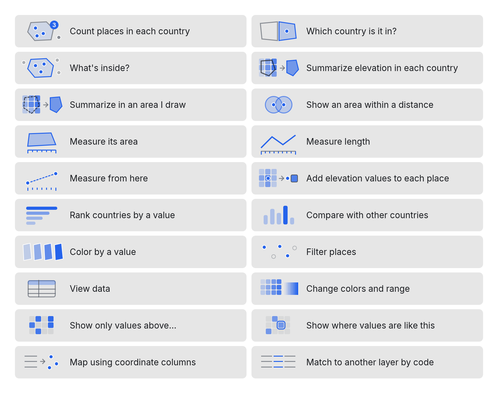
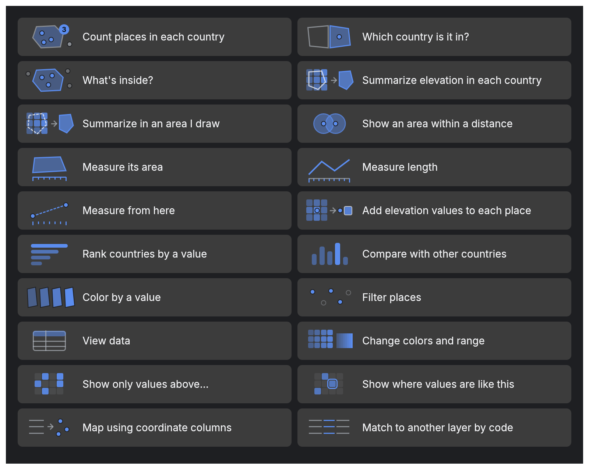

# Design review: illustrations for suggested actions

2026-10-17 · `crates/lm-ui/src/illustrations.rs` · gallery: `LM_GALLERY=dir cargo test -p lm-ui illustration_gallery -- --ignored`

The owner asked for small pictures beside the suggested actions that show what each action will do, for people who have never used GIS. The set was designed against Apple's Human Interface Guidelines (the apple-design skill: `icons.md`, `sf-symbols.md`, `menus.md`). We looked at how GIS references draw the same operations, critiqued those drawings by the same standard, and kept only what survives.

## What GIS references draw, and why we didn't copy it

| Source | What it shows | Critique (Apple's standard) | What we kept |
| --- | --- | --- | --- |
| Esri, "How zonal statistics works" (ArcGIS Pro help) and similar diagrams, such as the zones-on-a-grid figure the owner sent | A fine grid of cells, several zones, labels ("zone1"), sometimes the cell values printed | It **explains the method, not the result**: a reader sees a grid but not "you get one value per area". Too much detail to read at button size (`icons.md › Best practices`: "Create a recognizable, highly simplified design. Too many details can make an interface icon confusing or unreadable"). It uses words ("zone1"), which Apple keeps out of icons unless essential. It has no hierarchy: zones, grid and labels all carry the same weight. | A few tinted squares mean "a grid of values"; one outline means "an area". |
| QGIS Processing icons (e.g. Count points in polygon uses the shared `mAlgorithmSumPoints.svg`) | A generic "sum points" glyph, shared by several tools, in several colours | One picture for different ideas fails "a single concept"; the Σ is jargon to a novice. QGIS's own tracker records inconsistent and missing icons (bugs #8691 and #19082). | Dots inside an outline for "places in an area". |
| Esri Buffer / Spatial Join tool icons | Concentric rings around a feature; two overlapping layer stacks | The rings are a good, familiar metaphor. Overlapping layer stacks say "two layers", not what happens. | Rings for "within a distance". |

## The rules we drew with

1. **Show the result, not the method.** Inputs are faint and the result is the one strong element. For example, Summarize shows many tinted squares under an outline, an arrow, then the area filled with one colour. This is Apple's hierarchical rendering: one accent colour at three strengths, with grey for context (`sf-symbols.md › Rendering modes`).
2. **One idea and a handful of shapes, from metaphors people already know.** Dots are places, an outline is an area, tinted squares are a grid of values, bars are a ranking, a ruler is a measurement.
3. **One family.** Every picture is drawn on the same 56 × 32 grid (shown at 70 × 40), with 1.5 pt strokes at the label's weight and the same top-down view (`icons.md`: "consistent size, level of detail, stroke thickness (or weight), and perspective").
4. **No words, with one exception:** the numeral on Count, because the number is the idea (`icons.md`: "Include text in your design only when it's essential").
5. **Pictures support labels; they never replace them.** The label always says what happens. Each button reports its label to VoiceOver (`icons.md › Provide alternative text labels`).
6. **Drawn in code with the theme's colours**, so light, dark and future accents work. On dark backgrounds the faintest tints are lifted so they don't vanish.
7. **All or none in a group** (`menus.md › Icons`). Every suggested-action button has a picture. The More actions menu has none, to keep it a plain list.

## Self-critique after the first render, and what changed

| Finding | Change |
| --- | --- |
| At 56 × 32 pt, the grid-based pictures (Summarize, Values above, Similar values) were too small to read | Drawn at 70 × 40 on the same grid; buttons 52 pt tall |
| Summarize's outline over the grid was grey on blue and got lost | Outlines over a grid use the text colour at 75% |
| The "Add values" tag was cramped against the arrow | The place is shown again beside a swatch of its square's colour |
| Dark mode: the lightest tints were nearly invisible | Tints keep at least 30% strength on dark backgrounds |
| Labels showed `populated_places` | Button labels replace underscores with spaces |

## Open questions for the owner

- **Filter** shows kept places as solid dots and hidden ones as rings. Is that clear, or would the standard filter symbol (three shortening lines) be better here?
- **Match to another layer by code** (Phase 6) is the most abstract picture. It may need a better metaphor when it ships.
