# Design review: the Style tab (symbology controls)

Reviewed 2026-10-17 with the `apple-design` skill (github.com/dickwu/apple-design-skill), which
grounds each finding in Apple's Human Interface Guidelines. Platform: macOS desktop app built
with egui, so the guidelines apply as design principles in egui terms. Audience: people with no
GIS training who want to look at their data and make a clear map. Artifacts: renders of the
Style tab at 1.5×, the theme's hex values, and the code (`crates/lm-ui/src/inspect.rs`).

**Rollback.** The version reviewed here is tagged `ui-before-apple-review` (commit 180b974). The
changes are on branch `phase-3-ui-polish`. Its build is kept beside the old one in the iCloud
builds folder (`…-before-ui-review…` and `…-ui-review…`). To go back:
`git checkout phase-3`, or `git revert` the polish commit after a merge.

## Summary

The panel's job is to turn a layer into a readable map in a few clicks. The strongest thing
about it is the preset tiles, which are drawn from the layer's own fields and palettes. Before
the review the panel had no consistent structure:

- each control had its own label pattern (headings, inline labels, trailing labels);
- the legend sat between the Color and Size controls;
- checkboxes and slider tracks were nearly invisible.

**Rating before: Critical issues** (one accessibility failure). **After: Good.**

## Critical

- **What:** checkboxes, slider tracks, value boxes and pop-up buttons were filled with
  `#F6F7F9` and had no edge on the white `#FFFFFF` panel: **1.07:1**. "Fit range to view" and
  "Show only values above…" showed as a faint circle. "Outline" showed a bare check mark with no
  box, so an unchecked box could not be seen at all.
  **Why:** `accessibility.md › Vision`: "Strive to meet color contrast minimum standards… between
  foreground text and icons and background colors". `color.md › Inclusive color`: "Avoid using
  colors that make it hard to perceive content in your app."
  **Fix (done):**
  - A new token, `control_stroke`: `#868C95` in light (3.39:1 on white, 3.16:1 on `#F6F7F9`)
    and `#767B84` in dark (3.87:1 on `#1E1F22`).
  - `form::checkbox` draws a 14 px box with that edge; when on, it is filled with the accent
    colour and shows a white check.
  - Pop-ups and value boxes inside the tab get the same edge (`form::with_visible_controls`).
  - Sliders fill the track with the accent colour from the minimum to the thumb, as macOS
    sliders do (`sliders.md › Desktop`: "the portion of track between the minimum value and the
    thumb is filled with color").

## Improvements

- **High: no single form structure.**
  - **What:** each control was labelled differently:
    - Color and Size had a heading above a pop-up;
    - Labels had an inline label beside its pop-up;
    - Opacity's label trailed its value box ("100% Opacity");
    - "Look" was a heading for a mixed bag of controls.
  - **Why:** `layout.md › Visual hierarchy`: "Align elements to make them easier to scan, and use
    indentation to convey hierarchy… Group related items." `sliders.md › Desktop`: "Consider
    using a label to introduce a slider."
  - **Fix (done):** an inspector form in the style of Keynote's Format pane:
    - a 72 px label column (Color, Palette, Groups, Size, Labels, Opacity) with controls beside
      it;
    - dependent controls (swatches, Smooth/Groups, the checkboxes) indented under their row;
    - groups separated by hairlines: presets | what to show | appearance | legend.
- **High: the legend split the controls.**
  - **What:** the legend sat between Color and Size, so the tab mixed what the style produces
    with the controls that set it.
  - **Why:** `layout.md › Visual hierarchy`, on grouping.
  - **Fix (done):** the legend is now the last section, under "Legend", as the result of
    everything above it.
  - **Trade-off:** in an 800 px window the legend now needs a scroll. The map itself and the
    Overview tab's legend show the result at once.
- **High: selection shown by colour alone, and controls that didn't look like controls.**
  - **What:**
    - the chosen palette was marked only by blue text under an unframed ramp;
    - "Smooth" and "Groups" were two loose text buttons;
    - preset names were truncated ("Single co…", "By contin…", "Size by p…").
  - **Why:**
    - `color.md › Inclusive color`: "Avoid relying solely on color to… communicate essential
      information."
    - `segmented-controls.md › Best practices`: "Consider a segmented control when it's
      important to group functions together, or to clearly show their selection state."
  - **Fix (done):** one selection language throughout:
    - palettes and presets are framed tiles; the selected one gets a 2 px accent ring and a
      semibold name;
    - colour swatches get the same ring;
    - Smooth | Groups and Equal counts | Equal steps are equal-width segmented controls;
    - preset names wrap to two lines instead of being cut off.
- **Medium: a disclosure that hid one row.**
  - **What:** "Classes" collapsed a single row (group count, method) behind GIS jargon.
  - **Why:** `disclosure-controls.md`: "Provide a descriptive label…"; progressive disclosure is
    for content that would otherwise overwhelm.
  - **Fix (done):** the Groups row appears only when Groups is chosen. That is the disclosure,
    with no extra control.
- **Medium: raster range wording.**
  - **What:** the raster range read "(2–98% of cells by default)", with "Back to 2–98%" and
    "Low"/"High" labels trailing the sliders.
  - **Fix (done):**
    - From and To rows;
    - the caption "Covers the middle 96% of cells", or the link "Reset to the middle 96% of
      cells" once changed;
    - "Only show values above" as a real checkbox.
- **Low: unnamed colour swatches.**
  - **What:** the eight colour dots had no names for tooltips or VoiceOver.
  - **Fix (done):** each has its Okabe–Ito name (Blue, Orange, Bluish green, Vermilion, Reddish
    purple, Sky blue, Yellow, Black) as a tooltip and accessibility label.

## Craft notes

- **Point of view:** the presets are drawn from the layer's own data, so "By continent" shows
  this layer's continent colours. Apple calls this out under Purpose; it is the panel's
  signature, and the review keeps it as the first thing in the tab. One thing was removed: the
  "Presets" heading, because the tiles explain themselves.
- **Capitalization:** LayeredMap uses sentence case throughout ("Fit range to view", "Equal
  counts"). Apple uses title case for buttons and segment labels. Keeping one convention matters
  more than which one, so sentence case stays. This is a judgment call, not a guideline.
- **Field names** such as `gdp_md` are shown as the data has them. Friendlier names belong with
  field roles (Details tab), not here.

## What works (keep)

- One undo step per slider drag; selection and camera are never undo steps.
- Colour-blind-safe defaults: Okabe–Ito for categories; Viridis and Cividis for values.
- The count guard ("Larger areas tend to have higher counts. Color by count per km² instead?")
  speaks plainly and offers the fix in place.
- Light and dark have the same structure; every new colour has both variants.

## Platform notes

- egui has no native pop-up button or slider, so the new controls (`crates/lm-ui/src/form.rs`)
  copy macOS sizing and states:
  - 26 px rows;
  - pointer cursor and hover edge on tiles and segments;
  - checkbox, radio and selected-state information for accessibility.
- Keyboard focus on the custom tiles is not yet drawn. That is a follow-up for Full Keyboard
  Access (`accessibility.md › Mobility`).
- Elsewhere in the app, buttons and pop-ups still have no edge (the same 1.07:1 fill). Applying
  `control_stroke` app-wide is the next step if this tab is judged better.

## Before and after

| | Before | After |
|---|---|---|
| One colour | 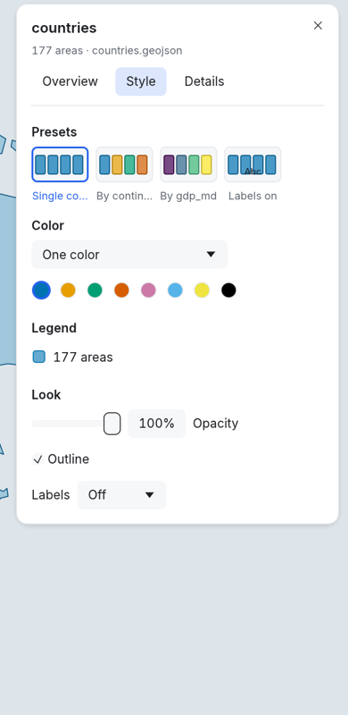 | 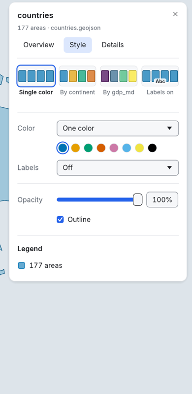 |
| By a value | 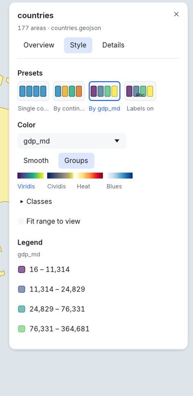 | 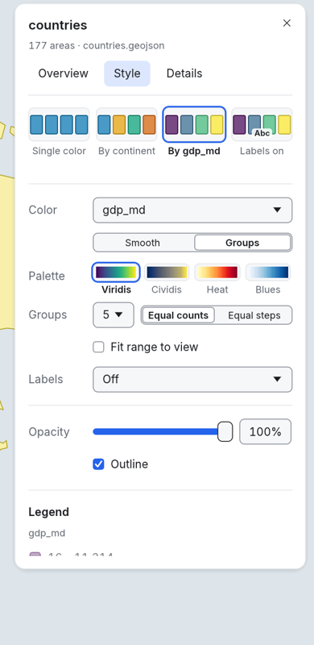 |
| By a category | 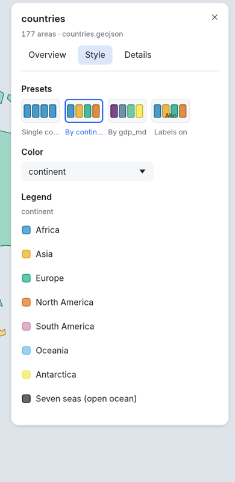 | 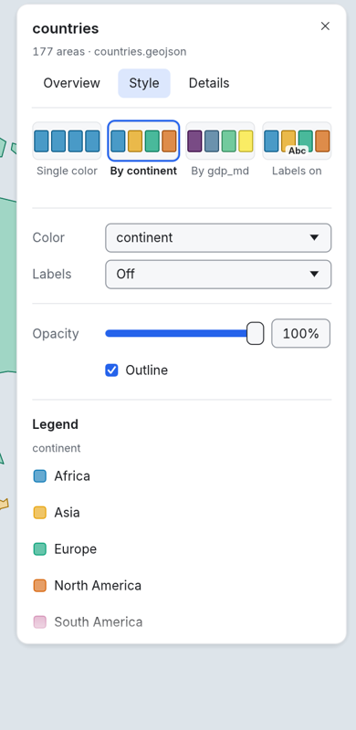 |
| Points, size by value | 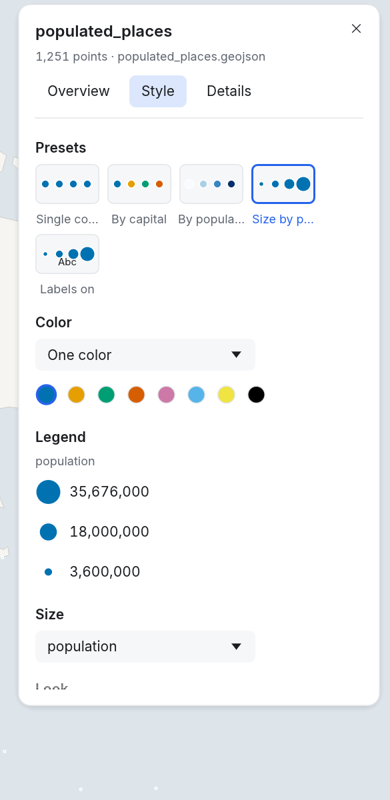 | 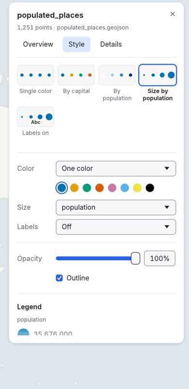 |
| Raster | 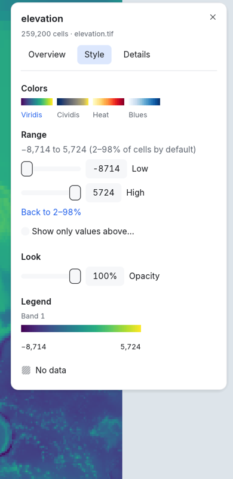 | 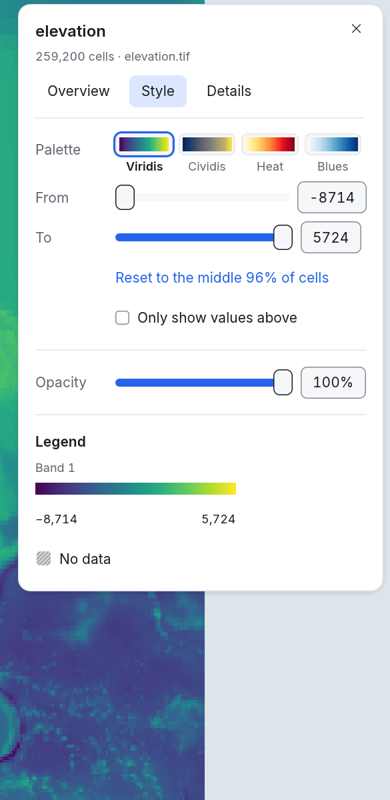 |
| Dark | 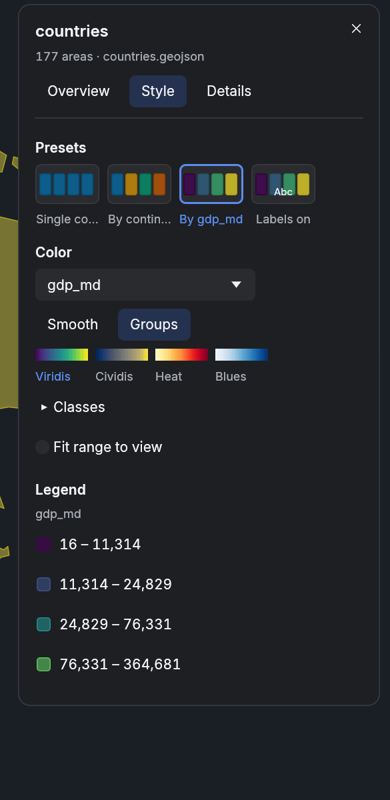 | 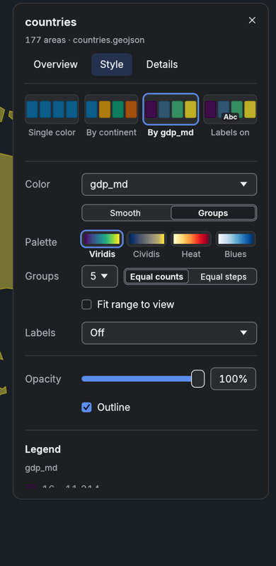 |

Regenerate these renders with
`LM_GALLERY=<dir> cargo test -p lm-ui style_gallery -- --ignored`.
